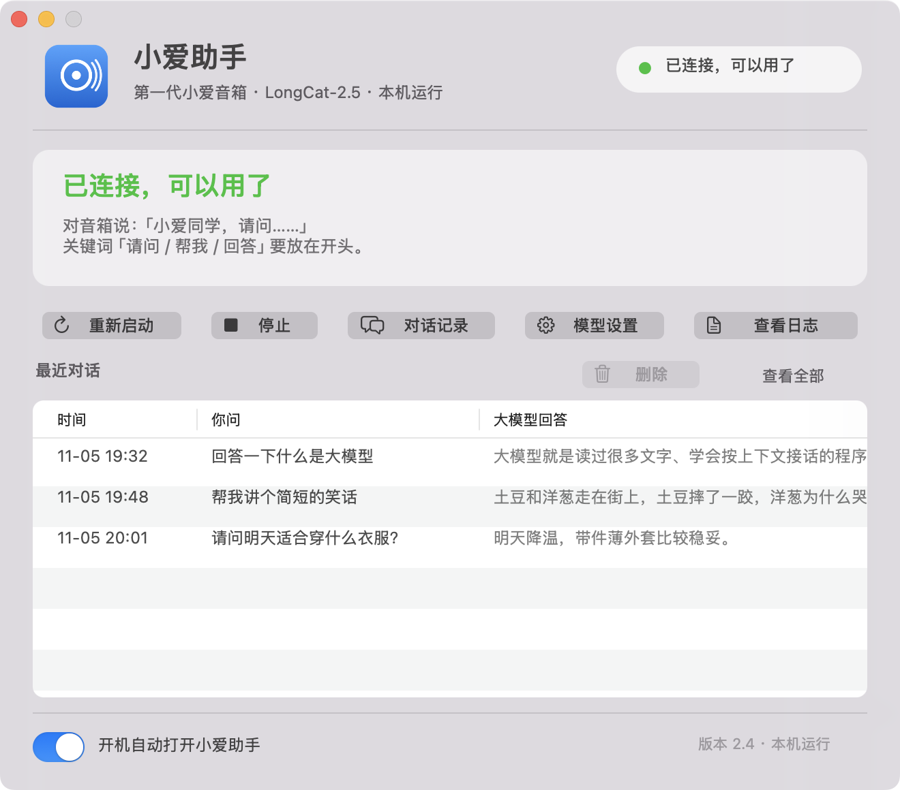

# 小爱助手 · 让第一代小爱音箱连上大模型

一个 macOS 原生小软件。不刷机、不拆机、保留小爱原厂固件，把「请问……」开头的问题交给大模型回答，再由音箱念出来。



> 目前只在**第一代小米 AI 音箱**（MDZ-25-DA / MDZ-25-DT，小米云硬件代号 S12 / S12A）上验证过。其他型号请勿直接照抄配置。

---

## 一、先说清楚：你需要自己准备什么

这个软件**不内置任何账号、密码或 API 密钥**。下载之前请先备齐：

| 需要准备 | 说明 |
| --- | --- |
| 一台 Mac | macOS 12 或更新；Intel / Apple Silicon 都可以（源码在本机编译） |
| 第一代小爱音箱 | 已用小米账号绑定，和 Mac 在同一个局域网 |
| 小米账号 + 密码 | 能收短信验证码；只存进你自己的 Mac「钥匙串」 |
| 大模型 API Key | 任意 OpenAI 兼容服务，示例用 LongCat-2.5；需自行申请，可能产生费用 |
| 音箱设备编号 DID | 安装脚本可自动在局域网探测 |
| Python 3.11 或更新 | 安装脚本会检查并提示 |

也就是说：**不存在「下载下来什么都不填就能用」**。账号和密钥属于你，软件只是把它们串起来。

---

## 二、它是怎么工作的

```
你对音箱说话
   ↓
小米云生成对话记录
   ↓
本机软件轮询读到，命中「请问 / 帮我 / 回答」开头
   ↓
把问题发给大模型
   ↓
拿回文字 → 小米云 TTS → 音箱播报
```

不接管麦克风、不改固件。代价是走了一圈小米云，会有 1–3 秒延迟，小爱有时先答一句再被打断，属于正常现象。

---

## 三、安装

1. 下载仓库 zip 并解压（或 `git clone`）
2. 双击 `安装.command`
3. 按中文弹窗依次填写：小米账号、密码、大模型 Key；设备编号可自动探测
4. 首次登录会弹一次短信验证码，填进去即可
5. 完成后自动编译并装进「应用程序」，启动台里能看到蓝色小爱图标

安装全程只在本机进行。编译出来的 App 不经过网络下载，不会被 macOS 拦成「身份不明的开发者」。

---

## 四、日常使用

双击打开「小爱助手」→ 状态变成绿色「已连接，可以用了」→ 对音箱说：

> 小爱同学，请问明天长沙天气怎么样

关键词**必须在开头**，否则仍由小爱自己回答。

软件首页直接显示最近对话；选中一条点「删除」或按 Delete 键可删掉，支持多选。「模型设置」里可以随时换成别的大模型 API。

---

## 五、常见问题

| 现象 | 处理 |
| --- | --- |
| 音箱没声音 | 确认状态是绿色；确认问句以「请问」开头；查看软件里的「查看日志」 |
| 反复要短信验证码 | 小米账号风控，重新运行一次安装向导完成验证 |
| 换了模型没生效 | 在「模型设置」点「测试连接」，再点「保存并重启」 |
| 提示「身份不明的开发者」 | 说明你拿到的是别人编译好的二进制；请改用本仓库源码本地安装 |
| Apple Silicon 机器报错 | 源码本地编译可自动适配；若用预编译包则需 Rosetta 2 |

---

## 六、隐私

见 [PRIVACY.md](PRIVACY.md)。一句话：凭据只在你的钥匙串，对话记录只在你的硬盘，本项目没有服务器、没有统计、没有埋点。

---

## 七、免责声明

- 非小米官方产品，与小米公司无关。
- 通过小米云接口实现，可能受小米服务条款约束；账号使用风险自负。
- 大模型 API 可能产生费用，请自行设置额度上限。
- 本项目不承担账号、设备或数据损失责任，仅供个人学习与自用。

---

## 八、致谢

基于 [xiaogpt](https://github.com/yihong0618/xiaogpt)、[miservice](https://github.com/Yonsm/MiService)、`republic` 等开源项目，许可证与出处见 [LICENSE](LICENSE)。

---

## 九、如果你是发布者

这个仓库已按「可公开」标准整理，不含任何账号、密钥、真实问答或个人路径。上传到 GitHub：

1. 打开 <https://github.com/new>，仓库名填 `xiaoai-assistant`，选 **Public**，不要勾选任何初始化文件，点 **Create repository**。
2. 在新仓库页点 **Add file → Upload files**。
3. 把本目录里的全部文件拖进上传区，包括 `.gitignore` 和 `.github` 文件夹。
4. 填一句提交说明，点 **Commit changes**。

**不要在 Release 里上传编译好的 `.app`**：本机 adhoc 签名未公证，别人下载会被 macOS 拦住，而且路径对不上也跑不起来。让使用者用 `安装.command` 在自己电脑上编译，反而是最省事、最安全的方式。

发布前的完整注意事项与自检清单见 [PUBLISHING.md](PUBLISHING.md)。
